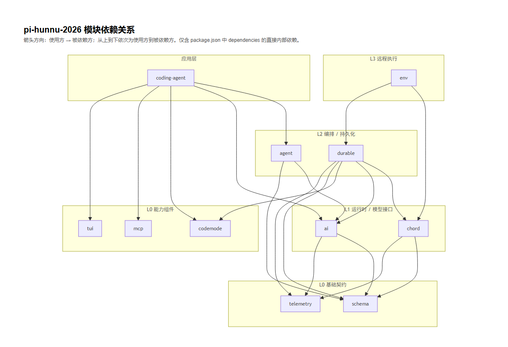
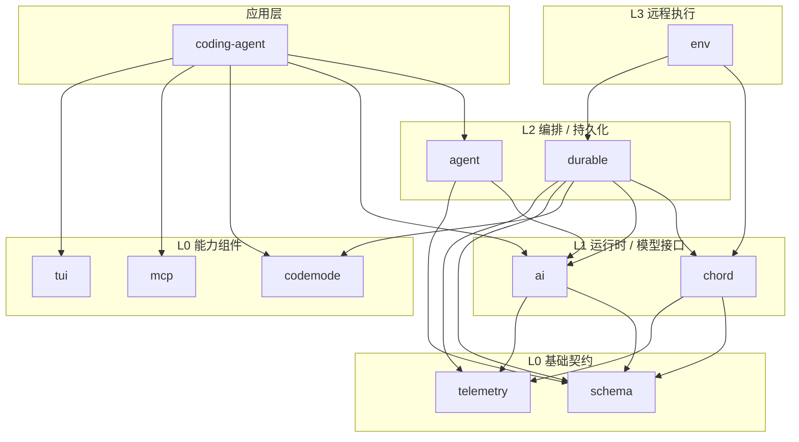

# 实践课2：小组组织建仓与 Pi Agent 源码阅读

- **姓名**：冉鹏洲
- **GitHub**：R4NZH0U
- **小组组织**：System-Analysis-Homework
- **小组代码仓库**：<https://github.com/System-Analysis-Homework/pi-hunnu-2026>
- **实际 clone 地址**：`https://github.com/System-Analysis-Homework/pi-hunnu-2026.git`
- **源码提交**：`c3cc91632d0a1950fb122605b190233f2aa0006e`（`main` 分支）
- **分析版本**：Pi 1.5.2（`packages/*/package.json` 的 `version` 均为 `1.5.2`；根 `package.json` 的 `version` 为 `0.0.3`，不是包版本）
- **本机环境**：Windows 11 家庭中文版（10.0.26100，build 26100）/ PowerShell 5.1.26100.6725 / Node.js v24.15.0 / npm 11.12.1 / Git 2.54.0.windows.1
- **本人重点分析模块**：`coding-agent`、`agent`、`ai`

---

## 1. 源码获取

### 1.1 小组组织仓库

小组仓库已经 fork 到 **System-Analysis-Homework** 组织下，仓库名为 `pi-hunnu-2026`。GitHub 页面可以看到组织归属、fork 来源 `hunnuOpenSourceSoftware2026/pi-hunnu-2026`，以及最新提交 `c3cc916`。


### 1.2 克隆到本地并确认版本

仓库约 110 MB，为了只检出本次分析需要的 `packages` 与 `scripts`，我使用了浅克隆 + 稀疏检出：

```powershell
git clone --depth 1 --filter=blob:none --sparse `
  https://github.com/System-Analysis-Homework/pi-hunnu-2026.git `
  D:\pi-hunnu-2026
cd D:\pi-hunnu-2026
git sparse-checkout set packages/telemetry packages/schema packages/chord packages/tui `
  packages/codemode packages/mcp packages/ai packages/durable packages/env `
  packages/agent packages/coding-agent packages/evals scripts
```

`origin` 仍指向小组组织仓库，分支和提交与远端一致；稀疏检出只影响本地工作区文件，不改变仓库来源和 commit。


核对结果：

| 检查项 | 结果 |
| --- | --- |
| 当前目录 | `D:\pi-hunnu-2026` |
| `origin` fetch | `https://github.com/System-Analysis-Homework/pi-hunnu-2026.git` |
| `origin` push | `https://github.com/System-Analysis-Homework/pi-hunnu-2026.git` |
| 当前分支 | `main` |
| HEAD 完整提交 | `c3cc91632d0a1950fb122605b190233f2aa0006e` |
| `git status --short` | 无输出，工作区干净 |

### 1.3 源码目录

`packages/` 下实际有 12 个目录，其中 `evals` 是课程任务表中没有单列的私有评测包；本次任务要求分析的 11 个构建模块都在这里：

```text
packages/
├── agent
├── ai
├── chord
├── codemode
├── coding-agent
├── durable
├── env
├── evals          # 实际存在，但不参与根 build 链
├── mcp
├── schema
├── telemetry
└── tui
```


### 1.4 构建验证

在仓库根目录执行：

```powershell
npm install --ignore-scripts --no-audit --no-fund
npm run build
```

本机实际结果：安装 287 个包，构建 **exit code 0**。构建末尾输出：

```text
> @earendil-works/pi-coding-agent@1.5.2 build
> npm run build:unbundled && node ../../scripts/build-coding-agent-bundle.mjs
...
Built packages\coding-agent\dist\bundle (84 files, 9.4 MiB)
```

`ai` 的构建还实际生成了模型目录数据：

```text
Generated provider catalogs and src/models.generated.ts
Generated JSON model values under src/providers/data/
Total tool-capable models: 1692
Reasoning-capable models: 1454
Generated model data is valid.
```

---

## 2. 模块分析

### 2.1 根构建顺序

根目录 `package.json` 的 `scripts.build` 不是 `npm run build --workspaces`，而是把 11 个包按固定顺序串起来：

```text
① telemetry → ② schema → ③ chord → ④ tui → ⑤ codemode → ⑥ mcp
→ ⑦ ai → ⑧ durable → ⑨ env → ⑩ agent → ⑪ coding-agent
```

对应脚本（节选）：

```json
"build": "cd packages/telemetry && npm run build && cd ../schema && npm run build && cd ../chord && npm run build && cd ../tui && npm run build && cd ../codemode && npm run build && cd ../mcp && npm run build && cd ../ai && npm run build && cd ../durable && npm run build && cd ../env && npm run build && cd ../agent && npm run build && cd ../coding-agent && npm run build"
```

### 2.2 模块分析表

| 子文件夹 | 代码主要实现什么功能 | 本模块 build 执行什么、生成什么 | 直接依赖哪些内部模块 | 依据文件或代码位置 |
| --- | --- | --- | --- | --- |
| `telemetry` | 厂商无关的 telemetry 契约：`TelemetryContext` / `TelemetrySpan`、span/event/attribute/status、counter/up-down counter/histogram、`NOOP` 和内存实现；不绑定 OpenTelemetry/Sentry，也不保存全局 current span。 | `tsc -p tsconfig.build.json`；生成 `dist/` 32 个文件（`.js`、`.d.ts`、`.js.map`、`.d.ts.map`），无 bundling。 | 无内部依赖。 | `packages/telemetry/package.json` 的 `scripts.build` 与空 `dependencies`；`README.md`；`src/index.ts`、`memory.ts`、`metrics.ts`、`noop.ts`、`render.ts`。 |
| `schema` | 用 TypeScript builder 构造普通 JSON Schema，并把 schema 编译成闭包校验器；不依赖 `eval`，支持 Draft 2020-12/7、错误 JSON Pointer、可选 format 校验；Chord/ai/agent 用它描述参数和工具输入。 | `tsc -p tsconfig.build.json`；生成 `dist/` 172 个文件，含 `builders`、`compiler`、`validator`、`formats/` 等 JS、声明和 source map。 | 无内部依赖。 | `packages/schema/package.json` 的 `scripts.build`、空 `dependencies`；`src/{builders,compiler,validator,types}.ts`；`README.md`。 |
| `chord` | 跨进程对象运行时：对象类型/契约、facet 插件、引用（reference）、document/store、link、HTTP/workers、plugins 热重载，以及 web/React/tui 客户端 surface。 | `tsc -p tsconfig.build.json`；生成 `dist/` 1,196 个文件（约 7.8 MB），保留多个子路径入口（`/context`、`/sqlite`、`/http`、`/workers`、`/plugins`、`/react`、`/tui` 等）。 | `schema`、`telemetry`。`esbuild`、`ws`、`react` 是 **可选外部 peer**，不是内部模块。 | `packages/chord/package.json` 的 `dependencies`、`peerDependencies`、`peerDependenciesMeta`；`tsconfig.build.json`；`src/{index,context,documents,host,link,node,react,sqlite,store,tui,web}.ts`。 |
| `tui` | 终端 UI 框架：主屏/备用屏 TUI、差分渲染、同步输出、组件（Text/Editor/Markdown/SelectList/Image/ScrollView 等）、键盘与 autocomplete、终端图片。 | `tsc -p tsconfig.build.json`；生成 `dist/` 184 个文件（约 2.1 MB）。根 `build` **不执行** `build:native:darwin/linux/win32`，原生加速模块属于单独构建。 | 无内部依赖。 | `packages/tui/package.json` 的 `scripts.build` 与 `build:native:*`；`src/tui.ts`、`src/components/`、`src/editor-component.ts`；`README.md`。 |
| `codemode` | 在 QuickJS（WASM）沙箱里运行模型写的 JavaScript；只暴露注入的 `tools`、`text`、`image`、`store` 等能力，嵌套工具调用不进入 LLM 上下文。支持 Node worker 与 Cloudflare Durable Object 两种沙箱。 | `tsc -p tsconfig.build.json`；生成 `dist/` 64 个文件，含 `index`、`portable`、`cloudflare`、`runtime/`、WASM loader。 | 无内部依赖。 | `packages/codemode/package.json` 的 `scripts.build`、`dependencies`（`quickjs-wasi`）；`src/index.ts`、`portable.ts`、`cloudflare.ts`、`runtime/`；`README.md`。 |
| `mcp` | 独立 MCP（Model Context Protocol）客户端：transport-neutral client core、stdio、Streamable HTTP、pipe、测试 transport、OAuth、协议消息与工具结果转换；不依赖官方 MCP SDK。 | `tsc -p tsconfig.build.json`；生成 `dist/` 112 个文件，含 `client`、`transports/`、`protocol/`、`oauth/`、`testing/`。 | 无内部依赖。源码里只在注释中提到 `pi-ai` 的 `TextContent`/`ImageContent` 和 `pi-env` 的 `RemoteProcess`，没有实际 import，也没有在 `dependencies` 中声明。 | `packages/mcp/package.json` 的 `scripts.build`、`dependencies`（仅 `cross-spawn`）；`src/client.ts`、`src/transports/`、`src/protocol/`、`src/oauth/`；`README.md`。 |
| `ai` | 统一 LLM 访问层：provider 集合、模型目录、认证/API Key/OAuth、token 与成本、流式响应、工具调用、图片/分类模型、cross-provider handoff；同时给 agent/durable 提供模型接口。 | 先 `npm run generate-models`：抓取 models.dev、NVIDIA NIM、OpenRouter、Vercel AI Gateway、Radius 等目录，生成 `src/models.generated.ts` 和 `src/providers/data/` 下 44 个 JSON；再 `build:offline`：`check:model-data` → `tsc` → 清理并复制数据到 `dist/providers/data`。生成 `dist/` 884 个文件（约 4.2 MB）。 | `schema`、`telemetry`。 | `packages/ai/package.json` 的 `scripts.build`、`build:offline`、`generate-models`；`catalog/`；`src/models.generated.ts`、`src/providers/data/`；`README.md`。 |
| `durable` | 可持久化 agent harness：对话、模型 turn、工具调用和自定义 state 先写入存储，进程中断后恢复；包含 storage、session、harness、tools、codemode、tool-search、env、images 等子模块。 | `tsc -p tsconfig.build.json`；生成 `dist/` 408 个文件（约 4.3 MB），保留 `codemode/`、`env/`、`harness/`、`session/`、`storage/`、`tools/` 等子路径。 | `chord`、`ai`、`codemode`、`schema`、`telemetry`。 | `packages/durable/package.json` 的 `dependencies`；`tsconfig.build.json` 中指向 `../chord/dist`、`../ai/dist` 的 `paths`；`src/{harness,session,storage,tools,codemode}/`；`README.md`。 |
| `env` | Pi Durable 的远程执行环境：通过 SSH 连接远端，部署并运行一个 Rust daemon（`pi-env`），提供文件操作、命令/进程、终端、文件列表等；本地也提供基于 daemon 的 `LocalExecutionEnv`。 | 根 `build` 只执行 `tsc -p tsconfig.build.json`，生成 `dist/` 36 个文件（约 0.3 MB）。`build:daemon` 是单独的 `cargo build --manifest-path daemon/Cargo.toml --locked`，生成 Rust daemon（`pi-env`），**不在**根 `npm run build` 中。 | `chord`、`durable`。 | `packages/env/package.json` 的 `scripts.build` 与 `build:daemon`；`daemon/Cargo.toml`；`tsconfig.build.json` 指向 `../chord/dist/context`、`../durable/dist/env` 的 `paths`；`src/{connection,remote-env,ssh,process,terminal}.ts`；`README.md`。 |
| `agent` | 有状态 agent core（包名 `@earendil-works/pi-agent-core`）：Agent 类、agent loop、message/turn 事件、tool 执行、`convertToLlm`、`streamFn`、proxy；是 coding-agent 的直接下层。 | `tsc -p tsconfig.build.json`；生成 `dist/` 24 个文件（约 0.2 MB），含 `agent.js`、`agent-loop.js`、`stream-fn.js`、`types.js` 及声明/map。 | `ai`、`schema`。 | `packages/agent/package.json` 的 `dependencies`；`tsconfig.build.json` 指向 `../ai/dist/index.d.ts` 的 `paths`；`src/agent.ts`、`agent-loop.ts`、`stream-fn.ts`；`README.md`。 |
| `coding-agent` | 完整 Pi 编码 agent：CLI、交互式 TUI、RPC/JSON 模式、工具（read/bash/edit/write 等）、扩展、skills、prompt templates、themes、session、package manager、HTML 导出；最终发布为 npm 包/可执行 CLI。 | 两步：`build:unbundled` 执行 `tsc`，给 `dist/cli.js`、`dist/rpc-entry.js` 加可执行位，并复制 theme JSON、PNG、`export-html` 模板/vendor；然后 `node ../../scripts/build-coding-agent-bundle.mjs` 用 esbuild 打包 `cli`、`index`、`rpc-entry`，并生成 OAuth lazy entries、Bedrock lazy loader、codemode worker、image-resize worker。生成 `dist/` 1,141 个文件（约 18.8 MB），其中 `dist/bundle/` 84 个文件（9.4 MiB）。 | `agent`（agent-core）、`ai`、`codemode`、`mcp`、`tui`。不直接依赖 `durable`、`env`、`schema`。 | `packages/coding-agent/package.json` 的 `scripts.build`、`build:unbundled`、`copy-assets`、`dependencies`；`tsconfig.build.json` 中 `agent`/`ai`/`tui` 的 `paths`；`../../scripts/build-coding-agent-bundle.mjs`；`src/{cli,main,modes,extensions,core,tools}/`。 |

> 表中 `dist` 文件数和大小是本机 `npm run build` 后实际统计的结果，包含 `.js`、`.d.ts` 和 source map，不是源文件数量。

### 2.3 根 build 与子模块 build 的分工

- **根 build**：只读根 `package.json` 的 `scripts.build`，按固定顺序 `cd` 到每个包，再调用该包的 `npm run build`；不读取某个“全局构建顺序配置文件”。
- **子模块 build**：读取自己的 `package.json` 的 `scripts.build`，再读取 `tsconfig.build.json`；后者 `extends ../../tsconfig.base.json`，设置 `outDir: ./dist`、`rootDir: ./src`，并 include/exclude 源码。`tsconfig.base.json` 打开 `declaration`、`declarationMap`、`sourceMap`、`inlineSources`，所以输出是 ESM `.js` + `.d.ts` + 两类 map。
- **依赖包的解析**：`durable`、`env`、`agent`、`coding-agent` 的 `tsconfig.build.json` 还显式写了 `paths`，直接指向依赖包的 `../*/dist/*.d.ts`；`chord`、`ai` 等则通过 workspace 包的 `types` 字段解析到 `dist`。因此前置包必须先 build，否则类型声明不存在。
- **特殊 build**：
  - `ai` 的 `build` 会先联网抓取模型目录；`build:offline` 跳过联网抓取，只做已有数据的校验、编译和数据复制。
  - `coding-agent` 的 bundle 脚本会检查 `packages/coding-agent/dist/cli.js`、`packages/ai/dist/api/bedrock-converse-stream.js` 等入口是否存在，缺失会直接报 `Build the workspace packages first.`。
  - `env` 的 Rust daemon、`tui` 的原生模块、`coding-agent` 的 Bun 单文件二进制，都属于单独脚本，不在根 `npm run build` 中。

### 2.4 模块层级与依赖关系图

图为“**使用方 → 被依赖方**”方向，按层从上到下排列：越靠上越接近使用方，越靠下越接近被依赖方。图中只画 `package.json` 中 `dependencies` 的直接内部依赖；`peerDependencies`、开发依赖和测试依赖不进入这张图。



可编辑图源：[`assets/deps.mermaid`](assets/deps.mermaid)

**层级划分依据**：按直接内部依赖的最长路径深度分层，再结合职责命名。

- **应用层**：`coding-agent`，最终 CLI 产品，依赖 `agent`、`ai`、`codemode`、`mcp`、`tui`。
- **L3 远程执行**：`env`，依赖 `chord`、`durable`。
- **L2 编排 / 持久化**：`agent`（依赖 `ai`、`schema`）、`durable`（依赖 `chord`、`ai`、`codemode`、`schema`、`telemetry`）。
- **L1 运行时 / 模型接口**：`chord`、`ai`，都只依赖 `schema`、`telemetry`。
- **L0 能力组件**：`tui`、`codemode`、`mcp`，无内部依赖，可独立使用。
- **L0 基础契约**：`schema`、`telemetry`，无内部依赖。

**可选/开发依赖区分**：

- `chord` 的 `peerDependencies` 是 `esbuild`、`react`、`ws`，且 `peerDependenciesMeta` 都标了 `optional: true`；它们只在 `/plugins`、`/react`、`/http`、`/tui/launcher` 等入口用到，不是内部模块，因此不画入依赖图。
- `vitest`、`@types/*`、`chalk`、`@xterm/headless` 等是测试/类型/开发依赖，不进入运行时依赖图，也不画成实线。
- `packages/evals` 是私有评测包，根 build 不构建它；`apps/` 下的 `p2`、`p2-mac`、`p3` 也不在根 `build` 链中，因此没有画入 11 个模块的依赖图。

---

## 3. 三个问题

### 问题 1：根目录与子模块的 `npm run build` 分别读取什么配置、执行什么工作？

**根目录**的 `npm run build` 读取根 `package.json` 的 `scripts.build`。它没有使用 `npm workspaces` 的并行构建，而是手写了一条固定顺序的 `cd ... && npm run build && ...` 命令链，从 `telemetry` 一直执行到 `coding-agent`。它本身不读 `tsconfig`，真正的编译配置由每个子模块读取。

**子模块**的 `npm run build` 读取自己的 `package.json` 和 `tsconfig.build.json`：

- `telemetry/schema/chord/tui/codemode/mcp/durable/env/agent` 基本都是 `tsc -p tsconfig.build.json`，把 `src/**/*.ts` 编译到 `dist/`，生成 ESM JS、`.d.ts`、`.js.map`、`.d.ts.map`。
- `ai` 多一步模型目录生成：`generate-models` 抓取外部模型目录，生成 `src/models.generated.ts` 和 `src/providers/data/*.json`；`build:offline` 再校验、编译，并把 provider data 复制到 `dist/providers/data`。
- `coding-agent` 先 `tsc` 生成 unbundled `dist`，加可执行位、复制主题/图片/HTML 模板；再用 esbuild 打包成 `dist/bundle`，并额外生成 OAuth、Bedrock、codemode、image-resize 等 lazy entry。
- `env` 的根 build 只编译 TypeScript；Rust daemon 是单独的 `build:daemon`。`tui` 的原生模块、`coding-agent` 的 Bun 二进制也是单独脚本。

所以，根 build 负责“按顺序调度”，子模块 build 负责“按各自的 tsconfig 和脚本生成 dist”。

### 问题 2：构建顺序和模块依赖有什么关系？相邻构建的模块是否一定互相依赖？

构建顺序与依赖方向一致：**被依赖的包先构建，使用它的包后构建**。例如：

- `schema`、`telemetry` 没有内部依赖，排在最前；`chord` 依赖它们，排在后面。
- `chord`、`ai` 先于 `durable`，因为 `durable` 同时依赖两者。
- `agent` 先于 `coding-agent`，因为 coding-agent 依赖 agent core。
- `codemode`、`mcp`、`tui` 都先于 `coding-agent`，因为 coding-agent 直接依赖它们。

但**相邻构建的模块不一定互相依赖**。例如：

- `chord → tui`：tui 不依赖 chord，二者只是相邻；
- `tui → codemode`、`codemode → mcp`、`mcp → ai`：这些相邻对都没有直接依赖；
- `env → agent`：env 与 agent 没有直接依赖；
- `durable`、`env` 排在 `coding-agent` 前面，但 coding-agent 的 `package.json` 并不依赖 durable/env；它们只是发布包集合中需要一起构建的独立分支。

因此，根 build 的顺序是一个**满足依赖约束的线性调度**，不是“相邻模块必须互相依赖”的链条。这样安排的好处是简单、可重复，并且保证 `tsc`/bundle 在前置包 `dist` 存在后再执行；代价是构建时间不能像 workspaces 并行调度那样压缩。

### 问题 3：选择一条涉及至少三个模块的依赖路径，说明这些模块如何分工

选择路径：

```text
coding-agent → agent → ai → schema
                         └→ telemetry
```

这是“使用方 → 被依赖方”的方向，涉及 5 个模块：

1. **`coding-agent`（应用层）**：面向用户的 CLI/TUI/RPC 入口，解析命令、加载扩展/skills/themes、管理 session 和工具，把用户任务交给 agent core，并把事件渲染成终端界面。它还直接使用 `tui` 做界面、`codemode` 做沙箱、`mcp` 接外部工具。
2. **`agent`（控制层）**：实现有状态的 agent loop，维护 `AgentMessage` 与 LLM message 的转换，调用 `ai` 的流式接口，执行工具调用，并向 UI 发出 `agent_start`、`turn_start`、`message_*`、`tool_*` 等事件。它不负责具体 provider 的 HTTP 细节。
3. **`ai`（模型访问层）**：把不同 provider 统一成模型接口，处理认证、模型目录、token/成本、流式响应、工具调用和图片/分类模型；它用 `schema` 描述/校验工具参数，用 `telemetry` 记录请求 span。
4. **`schema`（数据契约层）**：提供 JSON Schema builder、编译器和校验器，让工具参数、Chord 契约等有可序列化的 schema 和运行时校验，不依赖 `eval`。
5. **`telemetry`（可观测层）**：提供显式的 span/metrics 契约，让 `ai` 等模块记录模型请求和工具调用，而不用绑定某个 telemetry 后端。

这条路径体现了“**界面/应用 → 控制循环 → 模型访问 → 数据契约/可观测**”的分工：上层只组织任务和交互，下层负责可复用的模型、schema 和 telemetry 能力。`coding-agent` 不直接实现 LLM 请求，`agent` 不直接处理 provider 认证，`ai` 不直接决定 UI，这样后续替换模型、增加工具或接入新界面时，改动可以限制在对应层。

---

## 4. 实际版本差异与边界

1. **实际模块数**：任务表列出 11 个模块；实际 `packages/` 下还有 `evals`（`@earendil-works/pi-evals`，private，只有 `eval`/`test` 脚本，没有 `build`），根 `build` 不包含它。本报告只把 11 个构建模块画进依赖图。
2. **`apps/`**：仓库还有 `apps/p2`、`apps/p2-mac`、`apps/p3`，但它们不属于 `packages/` 的 11 个模块，也不在根 `build` 链中，本次不分析。
3. **根 `tsconfig.json` 的 `agent-old` 路径**：根 `tsconfig.json` 里还保留了 `@earendil-works/pi-agent-old` 的 path 映射，但当前 `packages/` 中没有 `agent-old` 目录；这是类型检查配置中的历史残留，不影响本次 11 个模块的 build。
4. **未纳入根 build 的可选构建**：`env` 的 Rust daemon、`tui` 的 native 模块、`coding-agent` 的 Bun 单文件二进制，都有独立脚本；本次实际执行的是根 `npm run build`，所以只验证了 TypeScript 编译和 coding-agent 的 esbuild bundle，没有声称已经构建了这三个可选产物。

---

## 5. 证据索引

- 根构建脚本：`package.json` 的 `scripts.build`、`scripts.build:offline`
- 共享编译配置：`tsconfig.base.json`、`tsconfig.json`
- 模块脚本与依赖：
  - `packages/telemetry/package.json`
  - `packages/schema/package.json`
  - `packages/chord/package.json`
  - `packages/tui/package.json`
  - `packages/codemode/package.json`
  - `packages/mcp/package.json`
  - `packages/ai/package.json`
  - `packages/durable/package.json`
  - `packages/env/package.json`
  - `packages/agent/package.json`
  - `packages/coding-agent/package.json`
- 构建配置：
  - `packages/*/tsconfig.build.json`
  - `packages/durable/tsconfig.build.json`、`packages/env/tsconfig.build.json`
  - `packages/agent/tsconfig.build.json`、`packages/coding-agent/tsconfig.build.json`
- 特殊构建脚本：
  - `scripts/build-coding-agent-bundle.mjs`
  - `scripts/package-files.mjs`
  - `packages/ai/catalog/generate.ts`
  - `packages/env/daemon/Cargo.toml`
- 源码入口：
  - `packages/telemetry/src/index.ts`
  - `packages/schema/src/index.ts`
  - `packages/chord/src/index.ts`
  - `packages/tui/src/tui.ts`
  - `packages/codemode/src/index.ts`
  - `packages/mcp/src/client.ts`
  - `packages/ai/src/index.ts`
  - `packages/durable/src/index.ts`
  - `packages/env/src/index.ts`
  - `packages/agent/src/index.ts`
  - `packages/coding-agent/src/cli.ts`

---

## 附：Mermaid 图源


