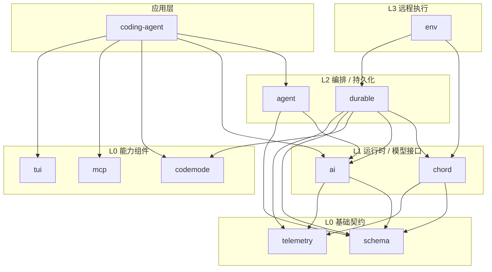

# 实践课2：组织建仓与源码分析 [姓名拼音]

> 填写说明：本文是报告模板 + 基于本地源码的“待核实草稿”。所有 `> **待填写：**` 或 `> **待核实：**` 的位置需要你本人确认、替换或补图后再提交。不要直接提交未核对的内容。

## 0. 个人信息

| 项目 | 内容 |
|---|---|
| 姓名 | 待填写（中文名） |
| 姓名拼音 | 待填写（用于 Issue 标题） |
| 学号 | 待填写 |
| 小组 Organization | 待填写（GitHub 组织名） |
| 小组仓库地址 | 待填写（`https://github.com/<org>/pi-hunnu-2026`） |
| 本人重点分析模块 | 待填写（见第 4 节） |
| 个人作业仓库 | 待填写（报告与图片所在仓库 URL） |

---

## 1. 源码获取

### 1.1 小组组织建仓（组长完成，组员核对）

> **待填写：** 在此贴出小组组织内 `pi-hunnu-2026` 仓库首页截图，需能看到 `Owner` 是小组 Organization。
> 图片建议放 `images/org-repo.png`，并确认提交后能正常显示：
>
> ```markdown
> 
> ```

核对要点：

- [ ] `Owner` 是小组 Organization，不是教师组织，也不是组长个人账号。
- [ ] 仓库名为 `pi-hunnu-2026`（若改名，说明新名称及原因）。
- [ ] 所有组员已加入 Organization，并具备后续开发所需权限。
- [ ] 已把仓库地址发给全体成员。

> **待填写：** 若有与本作业模板不一致的地方（如已存在 fork、改名），在此用 1-2 句说明。

### 1.2 下载源码并确认来源与版本

本人使用的 clone 命令（实际执行过的）：

```powershell
# 待核实：把下面的 URL 换成自己小组组织的仓库地址后，重新确认一次
git clone --branch main https://github.com/System-Analysis-Homework/pi-hunnu-2026.git
cd pi-hunnu-2026
```

> **实际 clone 地址（提交 Issue 时以纯文本 URL 贴出）：**
> 待填写：`https://github.com/<org>/pi-hunnu-2026`

本地核对输出（`Get-Location; git remote -v; git branch --show-current; git rev-parse HEAD; git status --short`）：

```text
# 待填写：粘贴你自己机器上的真实输出，不要照抄本文件
# 本地参考（本机 F:\open-source\pi-hunnu-2026 的实测值，需你确认是否就是你提交用的仓库）：
# 路径     : F:\open-source\pi-hunnu-2026
# origin   : https://github.com/System-Analysis-Homework/pi-hunnu-2026 (fetch/push)
# 当前分支 : main
# 提交编号 : c3cc91632d0a1950fb122605b190233f2aa0006e
# status   : 干净（无输出）
```

**截图要求 S1：** 同一张截图需同时显示当前目录、`git remote -v`、当前分支、完整提交编号（`git rev-parse HEAD`），以及源码目录列表。

> **待填写：** 插入 S1 截图，例如 ``。

**本报告采用的提交编号：** 待填写（把上面的完整 40 位编号填在这里，后续分析以该提交为准）。

---

## 2. 子模块功能与依赖分析

> **待核实：** 下表内容来自本地源码（`packages/*/package.json`、`tsconfig.build.json`、各模块 README）的初读，需你逐条打开对应文件核对后再定稿；若你的分支与本机版本有增减，请按实际代码修改并在表后说明差异。

| 子文件夹 | 代码主要实现什么功能 | 本模块 build 执行什么、生成什么 | 直接依赖哪些内部模块 | 依据文件或代码位置 |
|---|---|---|---|---|
| `telemetry` | 与厂商无关的遥测契约：`TelemetryContext` / `TelemetrySpan` 回调式接口和带类型的 schema 工具，供其它 pi 包上报指标与追踪 | `tsc -p tsconfig.build.json`，用 `src/**/*.ts` 生成 `dist/**/*.js` 与 `.d.ts`（含 sourcemap） | 无 | `packages/telemetry/package.json` 的 `scripts.build`、`dependencies`；`packages/telemetry/tsconfig.build.json`；`packages/telemetry/README.md` |
| `schema` | 不依赖 `eval` 的 JSON Schema 构建与校验：把 schema 编译成普通闭包，兼容 CSP，支持 draft 2020-12 与 7 | `tsc -p tsconfig.build.json` → `dist/` 下的 JS + 类型声明 | 无 | `packages/schema/package.json`；`packages/schema/tsconfig.build.json`；`packages/schema/README.md` |
| `chord` | 跨进程“对象运行时”：契约、文档、store、link、可热重载插件，以及 HTTP、worker、Web、终端客户端 | `tsc -p tsconfig.build.json` → `dist/`（`main`/`types` 指向 `dist/index.js`、`dist/index.d.ts`） | `pi-schema`、`pi-telemetry` | `packages/chord/package.json`（`dependencies` 与 `main`/`types`） |
| `tui` | 终端 UI 库，带差分渲染与同步输出，用于无闪烁的交互式 CLI；另有独立 native 构建脚本 | `tsc -p tsconfig.build.json` → `dist/`；原生部分由 `build:native:win32/darwin/linux` 单独构建 | 无（只用 `get-east-asian-width`、`marked` 等外部包） | `packages/tui/package.json`；根 `package.json` 的 `build:native:*`；`packages/tui/README.md` |
| `codemode` | 在 QuickJS（编译为 WASM）沙箱里执行模型写的 JavaScript，唯一能力是调用注入的 tools | `tsc -p tsconfig.build.json` → `dist/` | 无（依赖外部 `quickjs-wasi`） | `packages/codemode/package.json`；`packages/codemode/README.md` |
| `mcp` | 独立、轻量的 Model Context Protocol 客户端，自带 stdio / Streamable HTTP 传输，不依赖官方 MCP SDK | `tsc -p tsconfig.build.json` → `dist/` | 无（依赖外部 `cross-spawn`） | `packages/mcp/package.json`；`packages/mcp/README.md` |
| `ai` | 统一 LLM API：provider 集合、自动鉴权、token/成本统计、上下文持久化与跨模型交接 | `npm run generate-models`（跑 `catalog/generate.ts --strict` 生成模型目录），再 `build:offline`：`check:model-data` → `tsc -p tsconfig.build.json` → 清理并复制 `src/providers/data` 到 `dist/providers` | `pi-schema`、`pi-telemetry` | `packages/ai/package.json` 的 `scripts.build` / `build:offline` / `generate-models`；`packages/ai/tsconfig.build.json` |
| `durable` | 可持久化的会话/任务/文档运行时：回合、工具调用与状态先落存储再展示，进程中断后可续跑（README 标注 Experimental） | `tsc -p tsconfig.build.json` → `dist/` | `chord`、`pi-ai`、`pi-codemode`、`pi-schema`、`pi-telemetry` | `packages/durable/package.json`；`packages/durable/README.md` |
| `env` | Pi Durable 的远程执行环境：`daemon/` 是部署到远端的 Rust 小守护进程，另有 `ExecutionEnv` 客户端，用带帧协议走 stdin/stdout（通常经 SSH） | `tsc -p tsconfig.build.json` → `dist/`（Rust daemon 不在该脚本内构建） | `chord`、`pi-durable` | `packages/env/package.json`；`packages/env/README.md` |
| `agent` | 通用 agent 核心：传输抽象、状态管理、附件支持，并执行工具、流式事件（构建在 `pi-ai` 上） | `tsc -p tsconfig.build.json` → `dist/` | `pi-ai`、`pi-schema` | `packages/agent/package.json`；`packages/agent/README.md` |
| `coding-agent` | 带 read / bash / edit / write 工具与会话管理的编程 agent CLI（`pi`），含 TUI 模式、RPC、扩展、MCP、codemode 等集成 | `build:unbundled`（`tsc` → 给 `dist/cli.js`、`dist/rpc-entry.js` 加可执行位 → `copy-assets` 复制主题/图片/HTML 模板），再 `node ../../scripts/build-coding-agent-bundle.mjs` 打出 `dist/bundle/cli.js` | `pi-agent-core`、`pi-ai`、`pi-codemode`、`pi-mcp`、`pi-tui` | `packages/coding-agent/package.json` 的 `scripts.build` / `build:unbundled` / `bin`；`packages/coding-agent/tsconfig.build.json` |

> **待填写：** 若你实际版本与本表不一致（例如多出/少了某个包、某个 build 脚本不同），在此逐条说明差异：
>
> - 差异 1：
> - 差异 2：

### 2.1 模块层级与依赖关系图

箭头方向统一为“使用方 → 被依赖方”，只画 `package.json` 里可直接查到的内部依赖（开发依赖 / peer 依赖不计入主图）。图中按层从下往上排列：越靠上越接近使用方，越靠下越接近被依赖方。



层级划分依据（按“最长依赖链深度”，不是构建顺序）：

- **L0 基础层：** `telemetry`、`schema`（无内部依赖）。
- **L0 能力层：** `tui`、`codemode`、`mcp`（可独立使用，仅依赖外部包）。
- **L1：** `chord`、`ai`（都只依赖 L0 的 `schema` / `telemetry`）。
- **L2：** `agent`（依赖 `ai`、`schema`）、`durable`（依赖 `chord`、`ai`、`codemode`）。
- **L3：** `env`（依赖 `chord`、`durable`）。
- **顶层应用：** `coding-agent`（依赖 `agent`、`ai`、`codemode`、`mcp`、`tui`）。

> **图源与图片：**
> - 可编辑图源：`docs/deps.mermaid`（已生成，Mermaid 源）。
> - 可阅读图片：`images/deps.png`（已用本机 Edge 无头模式渲染，可直接在提交中引用）。
> - 上图只含 `dependencies` 中的直接内部依赖。若需要展示 devDependencies 或 peerDependencies（如 `chord` 的 peer `esbuild`/`react`/`ws`），请另画一张并用不同线型或颜色标明，文字说明“可选/开发”依赖。
> - **待核实：** 请打开 `images/deps.png` 逐条核对箭头方向是否为“使用方 → 被依赖方”。

---

## 3. 三个问题的回答（草稿，需用自己的话改写）

### 3.1 根目录与子模块中的 `npm run build` 分别读取什么配置、执行什么工作？

- **根目录 `npm run build`：** 根 `package.json:15` 是一个硬编码的 `cd packages/<x> && npm run build` 串联脚本，本身**不读取任何构建配置文件**，只负责按固定顺序依次调用各子包的 `build`。
- **子模块 `npm run build`：** 绝大多数包是 `tsc -p tsconfig.build.json`，即读取本包的 `tsconfig.build.json`；该文件 `extends` 根 `tsconfig.base.json`（`target` ES2024、`module` Node16、`strict`、`declaration`、`sourceMap` 等），并设置 `outDir: ./dist`、`rootDir: ./src`，把 `src/**/*.ts` 编译成 `dist/` 下的 JS、`.d.ts` 和 sourcemap。
- **特殊包：**
  - `ai`：先跑 `catalog/generate.ts --strict` 生成模型目录，再 `check:model-data` → `tsc` → 用 `scripts/package-files.mjs` 清理并复制 `src/providers/data` 到 `dist/providers`。
  - `coding-agent`：先 `tsc` 并把 `dist/cli.js`、`dist/rpc-entry.js` 设为可执行、复制主题/图片/HTML 模板，再用 `scripts/build-coding-agent-bundle.mjs` 生成 `dist/bundle/cli.js`（`bin.pi` 指向它）。
  - `tui` 的原生二进制由根脚本 `build:native:win32/darwin/linux` 单独构建，不在 `build` 里。

> **待核实：** 用你机器上同一提交的 `package.json` 原文核对上述脚本名与行号；若版本不同请以实际为准。

### 3.2 构建顺序和模块依赖有什么关系？相邻构建的模块是否一定互相依赖？

- 根 `build` 的顺序是：`telemetry → schema → chord → tui → codemode → mcp → ai → durable → env → agent → coding-agent`。
- 这个顺序保证**被依赖方先于使用方**构建：例如 `chord` 在 `schema`/`telemetry` 之后、`ai` 在 `schema`/`telemetry` 之后、`durable` 在 `chord`/`ai`/`codemode` 之后、`coding-agent` 在 `agent`/`ai`/`codemode`/`mcp`/`tui` 之后（`coding-agent/tsconfig.build.json` 的 `paths` 直接指向 `../agent/dist`、`../ai/dist`、`../tui/dist`，必须是已构建产物）。
- **相邻构建的模块不一定互相依赖。** 反例：
  - `schema → chord` 相邻且 `chord` 确实依赖 `schema`，但 `tui` 紧跟在 `chord` 后面，`tui` 与 `chord` 之间没有依赖。
  - `env → agent` 相邻，但 `agent` 只依赖 `ai`/`schema`，与 `env`、`durable`、`chord` 都无关；它被放在后面只是为了用一个固定的拓扑序，而不是因为依赖 `env`。
- 结论：构建顺序是依赖关系的一个**拓扑排序的超集**——顺序能保证依赖成立，但顺序相邻不代表依赖成立。

### 3.3 选一条涉及至少三个模块的依赖路径，说明这些模块如何分工

路径：`coding-agent → agent → ai → schema`（`ai` 同时依赖 `telemetry`，可看作 `… → ai → telemetry`）。

- **`coding-agent`（使用方最顶层）：** 提供用户真正运行的 `pi` CLI 与 TUI/RPC 模式、read/bash/edit/write 工具、会话与扩展管理；它把 agent 循环、模型调用、沙箱执行、MCP 客户端和终端渲染组装成一个可执行产品。
- **`agent`（编排层）：** 维护 agent 状态（消息、附件、工具调用）、定义执行循环与事件流，并把工具调用结果回传给下一轮模型请求；它自己不做模型协议细节，而是调用 `ai`。
- **`ai`（模型访问层）：** 统一各家 LLM 的请求/响应与流式协议、provider 配置与鉴权、token 与成本统计，并把上下文在模型间交接；它依赖 `schema` 校验工具参数与结构化输出，依赖 `telemetry` 记录调用指标。
- **`schema`（校验基础层）：** 把 JSON Schema 编译成无 `eval` 的闭包校验器，供上层在信任边界（模型返回的工具参数、配置等）做校验。

因此三者是“产品组装 → agent 编排 → 模型接口 → 结构校验”的分层关系，改上层实现不需要改下层契约。

> **待填写：** 如需换一条路径（例如 `coding-agent → ai → telemetry` 或 `env → durable → chord → schema`），在此替换并重写分工说明。

---

## 4. 本人重点分析模块

> **待填写：** 写明本人重点分析的模块（建议 1-2 个），以及为什么选它、你实际读了哪些文件/函数。
>
> 示例格式：
> - 重点模块：`ai`
> - 关键文件：`packages/ai/src/index.ts`、`packages/ai/src/providers/*`、`packages/ai/catalog/generate.ts`
> - 我确认的事实：……

---

## 5. 提交前检查清单

- [ ] 报告标题格式为 `实践课2：组织建仓与源码分析 [姓名拼音]`。
- [ ] 已贴小组组织仓库截图，且 `Owner` 是小组 Organization。
- [ ] 已贴 S1 截图（目录、remote、分支、提交编号、目录列表）。
- [ ] 已在 Issue 正文以纯文本 URL 形式贴出实际 clone 地址。
- [ ] 模块表逐行核对过 `package.json`，并说明与模板的差异（如有）。
- [ ] 依赖图有可阅读图片和可编辑图源（`.mermaid` / `.drawio` / `.pptx`）。
- [ ] 三个问题用本人语言回答，未直接复制包简介。
- [ ] 已标明本人重点分析模块。
- [ ] 在个人作业仓库渲染预览，确认图片与 Mermaid 图都能正常显示。
- [ ] 在课程作业仓库提交 Issue：`实践课2：组织建仓与源码分析 [姓名拼音]`，正文包含个人报告链接和小组仓库链接。
