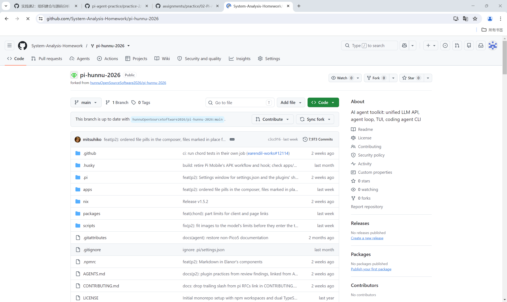
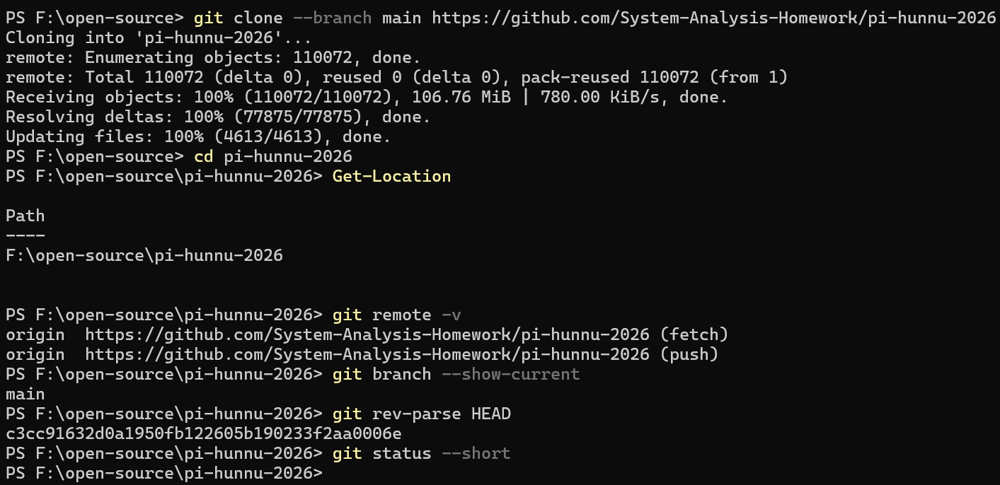
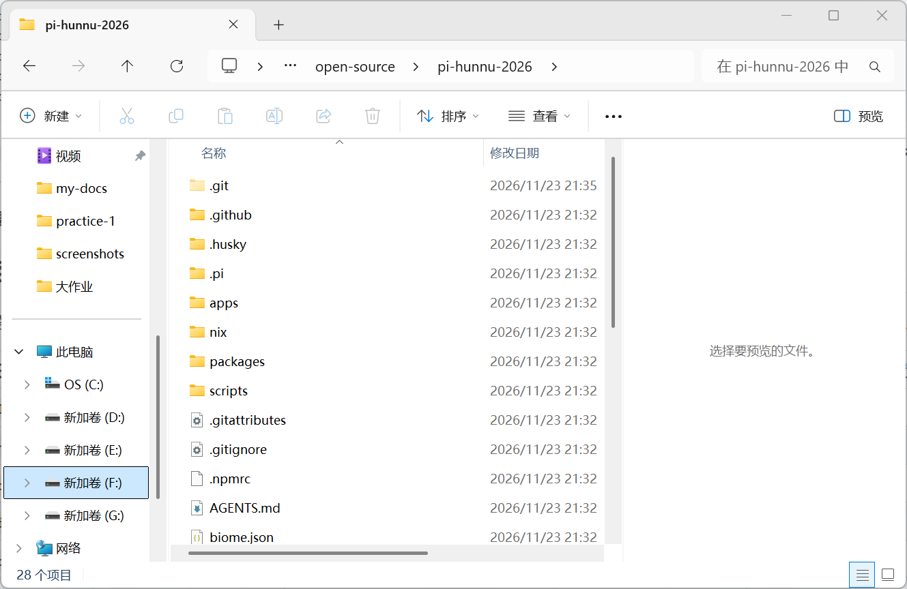

# 实践课2：小组组织建仓与 Pi Agent 源码阅读

- **姓名**：冉鹏洲
- **GitHub**：R4NZH0U
- **小组组织**：System-Analysis-Homework
- **小组代码仓库**：<https://github.com/System-Analysis-Homework/pi-hunnu-2026>
- **实际 clone 地址**：`https://github.com/System-Analysis-Homework/pi-hunnu-2026.git`
- **源码提交**：`c3cc91632d0a1950fb122605b190233f2aa0006e`
- **分析版本**：Pi 1.5.2（`package.json` 的 `version` 为 `1.5.2`）
- **本机环境**：Windows 11/ PowerShell 5.1 / Node.js v24.15.0 / npm 11.12.1 / Git 2.54.0
- **本人重点分析模块**：`telemetry`、`schema`、`chord`、`tui`、`durable`、`env`

---

## 1. 源码获取

### 1.1 小组组织仓库

小组仓库已经 fork 到 **System-Analysis-Homework** 组织下，仓库名为 `pi-hunnu-2026`。GitHub 页面可以看到组织归属、fork 来源 `hunnuOpenSourceSoftware2026/pi-hunnu-2026`，以及最新提交 `c3cc916`。




### 1.2 克隆到本地并确认版本

已检查 origin 指向小组组织内的仓库，当前分支为 main，并把完整提交编号记录到报告中。




### 1.3 源码目录

`packages/` 下实际有 12 个目录，其中 `evals` 是课程任务表中没有单列的私有评测包；本次任务要求分析的 11 个构建模块都在这里：

```text
packages/
├── agent
├── ai
├── chord
├── codemode
├── coding-agent
├── durable
├── env
├── evals          # 实际存在，但不参与根 build 链
├── mcp
├── schema
├── telemetry
└── tui
```




## 2. 模块分析

### 2.1 根构建顺序

根目录 `package.json` 的 `scripts.build` 不是 `npm run build --workspaces`，而是把 11 个包按固定顺序串起来：

```text
① telemetry → ② schema → ③ chord → ④ tui → ⑤ codemode → ⑥ mcp
→ ⑦ ai → ⑧ durable → ⑨ env → ⑩ agent → ⑪ coding-agent
```

对应脚本（节选）：

```json
"build": "cd packages/telemetry && npm run build && cd ../schema && npm run build && cd ../chord && npm run build && cd ../tui && npm run build && cd ../codemode && npm run build && cd ../mcp && npm run build && cd ../ai && npm run build && cd ../durable && npm run build && cd ../env && npm run build && cd ../agent && npm run build && cd ../coding-agent && npm run build"
```

### 2.2 模块分析表

| 子文件夹 | 代码主要实现什么功能 | 本模块 build 执行什么、生成什么 | 直接依赖哪些内部模块 | 依据文件或代码位置 |
| --- | --- | --- | --- | --- |
| `telemetry` | 厂商无关的 telemetry 契约：`TelemetryContext` / `TelemetrySpan`、span/event/attribute/status、counter/up-down counter/histogram、`NOOP` 和内存实现；不绑定 OpenTelemetry/Sentry，也不保存全局 current span。 | `tsc -p tsconfig.build.json`；生成 `dist/` 32 个文件（`.js`、`.d.ts`、`.js.map`、`.d.ts.map`），无 bundling。 | 无内部依赖。 | `packages/telemetry/package.json` 的 `scripts.build` 与空 `dependencies`；`README.md`；`src/index.ts`、`memory.ts`、`metrics.ts`、`noop.ts`、`render.ts`。 |
| `schema` | 用 TypeScript builder 构造普通 JSON Schema，并把 schema 编译成闭包校验器；不依赖 `eval`，支持 Draft 2020-12/7、错误 JSON Pointer、可选 format 校验；Chord/ai/agent 用它描述参数和工具输入。 | `tsc -p tsconfig.build.json`；生成 `dist/` 172 个文件，含 `builders`、`compiler`、`validator`、`formats/` 等 JS、声明和 source map。 | 无内部依赖。 | `packages/schema/package.json` 的 `scripts.build`、空 `dependencies`；`src/{builders,compiler,validator,types}.ts`；`README.md`。 |
| `chord` | 跨进程对象运行时：对象类型/契约、facet 插件、引用（reference）、document/store、link、HTTP/workers、plugins 热重载，以及 web/React/tui 客户端 surface。 | `tsc -p tsconfig.build.json`；生成 `dist/` 1,196 个文件（约 7.8 MB），保留多个子路径入口（`/context`、`/sqlite`、`/http`、`/workers`、`/plugins`、`/react`、`/tui` 等）。 | `schema`、`telemetry`。`esbuild`、`ws`、`react` 是 **可选外部 peer**，不是内部模块。 | `packages/chord/package.json` 的 `dependencies`、`peerDependencies`、`peerDependenciesMeta`；`tsconfig.build.json`；`src/{index,context,documents,host,link,node,react,sqlite,store,tui,web}.ts`。 |
| `tui` | 终端 UI 框架：主屏/备用屏 TUI、差分渲染、同步输出、组件（Text/Editor/Markdown/SelectList/Image/ScrollView 等）、键盘与 autocomplete、终端图片。 | `tsc -p tsconfig.build.json`；生成 `dist/` 184 个文件（约 2.1 MB）。根 `build` **不执行** `build:native:darwin/linux/win32`，原生加速模块属于单独构建。 | 无内部依赖。 | `packages/tui/package.json` 的 `scripts.build` 与 `build:native:*`；`src/tui.ts`、`src/components/`、`src/editor-component.ts`；`README.md`。 |
| `codemode` | 在 QuickJS（WASM）沙箱里运行模型写的 JavaScript；只暴露注入的 `tools`、`text`、`image`、`store` 等能力，嵌套工具调用不进入 LLM 上下文。支持 Node worker 与 Cloudflare Durable Object 两种沙箱。 | `tsc -p tsconfig.build.json`；生成 `dist/` 64 个文件，含 `index`、`portable`、`cloudflare`、`runtime/`、WASM loader。 | 无内部依赖。 | `packages/codemode/package.json` 的 `scripts.build`、`dependencies`（`quickjs-wasi`）；`src/index.ts`、`portable.ts`、`cloudflare.ts`、`runtime/`；`README.md`。 |
| `mcp` | 独立 MCP（Model Context Protocol）客户端：transport-neutral client core、stdio、Streamable HTTP、pipe、测试 transport、OAuth、协议消息与工具结果转换；不依赖官方 MCP SDK。 | `tsc -p tsconfig.build.json`；生成 `dist/` 112 个文件，含 `client`、`transports/`、`protocol/`、`oauth/`、`testing/`。 | 无内部依赖。源码里只在注释中提到 `pi-ai` 的 `TextContent`/`ImageContent` 和 `pi-env` 的 `RemoteProcess`，没有实际 import，也没有在 `dependencies` 中声明。 | `packages/mcp/package.json` 的 `scripts.build`、`dependencies`（仅 `cross-spawn`）；`src/client.ts`、`src/transports/`、`src/protocol/`、`src/oauth/`；`README.md`。 |
| `ai` | 统一 LLM 访问层：provider 集合、模型目录、认证/API Key/OAuth、token 与成本、流式响应、工具调用、图片/分类模型、cross-provider handoff；同时给 agent/durable 提供模型接口。 | 先 `npm run generate-models`：抓取 models.dev、NVIDIA NIM、OpenRouter、Vercel AI Gateway、Radius 等目录，生成 `src/models.generated.ts` 和 `src/providers/data/` 下 44 个 JSON；再 `build:offline`：`check:model-data` → `tsc` → 清理并复制数据到 `dist/providers/data`。生成 `dist/` 884 个文件（约 4.2 MB）。 | `schema`、`telemetry`。 | `packages/ai/package.json` 的 `scripts.build`、`build:offline`、`generate-models`；`catalog/`；`src/models.generated.ts`、`src/providers/data/`；`README.md`。 |
| `durable` | 可持久化 agent harness：对话、模型 turn、工具调用和自定义 state 先写入存储，进程中断后恢复；包含 storage、session、harness、tools、codemode、tool-search、env、images 等子模块。 | `tsc -p tsconfig.build.json`；生成 `dist/` 408 个文件（约 4.3 MB），保留 `codemode/`、`env/`、`harness/`、`session/`、`storage/`、`tools/` 等子路径。 | `chord`、`ai`、`codemode`、`schema`、`telemetry`。 | `packages/durable/package.json` 的 `dependencies`；`tsconfig.build.json` 中指向 `../chord/dist`、`../ai/dist` 的 `paths`；`src/{harness,session,storage,tools,codemode}/`；`README.md`。 |
| `env` | Pi Durable 的远程执行环境：通过 SSH 连接远端，部署并运行一个 Rust daemon（`pi-env`），提供文件操作、命令/进程、终端、文件列表等；本地也提供基于 daemon 的 `LocalExecutionEnv`。 | 根 `build` 只执行 `tsc -p tsconfig.build.json`，生成 `dist/` 36 个文件（约 0.3 MB）。`build:daemon` 是单独的 `cargo build --manifest-path daemon/Cargo.toml --locked`，生成 Rust daemon（`pi-env`），**不在**根 `npm run build` 中。 | `chord`、`durable`。 | `packages/env/package.json` 的 `scripts.build` 与 `build:daemon`；`daemon/Cargo.toml`；`tsconfig.build.json` 指向 `../chord/dist/context`、`../durable/dist/env` 的 `paths`；`src/{connection,remote-env,ssh,process,terminal}.ts`；`README.md`。 |
| `agent` | 有状态 agent core（包名 `@earendil-works/pi-agent-core`）：Agent 类、agent loop、message/turn 事件、tool 执行、`convertToLlm`、`streamFn`、proxy；是 coding-agent 的直接下层。 | `tsc -p tsconfig.build.json`；生成 `dist/` 24 个文件（约 0.2 MB），含 `agent.js`、`agent-loop.js`、`stream-fn.js`、`types.js` 及声明/map。 | `ai`、`schema`。 | `packages/agent/package.json` 的 `dependencies`；`tsconfig.build.json` 指向 `../ai/dist/index.d.ts` 的 `paths`；`src/agent.ts`、`agent-loop.ts`、`stream-fn.ts`；`README.md`。 |
| `coding-agent` | 完整 Pi 编码 agent：CLI、交互式 TUI、RPC/JSON 模式、工具（read/bash/edit/write 等）、扩展、skills、prompt templates、themes、session、package manager、HTML 导出；最终发布为 npm 包/可执行 CLI。 | 两步：`build:unbundled` 执行 `tsc`，给 `dist/cli.js`、`dist/rpc-entry.js` 加可执行位，并复制 theme JSON、PNG、`export-html` 模板/vendor；然后 `node ../../scripts/build-coding-agent-bundle.mjs` 用 esbuild 打包 `cli`、`index`、`rpc-entry`，并生成 OAuth lazy entries、Bedrock lazy loader、codemode worker、image-resize worker。生成 `dist/` 1,141 个文件（约 18.8 MB），其中 `dist/bundle/` 84 个文件（9.4 MiB）。 | `agent`（agent-core）、`ai`、`codemode`、`mcp`、`tui`。不直接依赖 `durable`、`env`、`schema`。 | `packages/coding-agent/package.json` 的 `scripts.build`、`build:unbundled`、`copy-assets`、`dependencies`；`tsconfig.build.json` 中 `agent`/`ai`/`tui` 的 `paths`；`../../scripts/build-coding-agent-bundle.mjs`；`src/{cli,main,modes,extensions,core,tools}/`。 |

> 表中 `dist` 文件数和大小是本机 `npm run build` 后实际统计的结果，包含 `.js`、`.d.ts` 和 source map，不是源文件数量。

### 2.3 根 build 与子模块 build 的分工

- **根 build**：只读根 `package.json` 的 `scripts.build`，按固定顺序 `cd` 到每个包，再调用该包的 `npm run build`；不读取某个“全局构建顺序配置文件”。
- **子模块 build**：读取自己的 `package.json` 的 `scripts.build`，再读取 `tsconfig.build.json`；后者 `extends ../../tsconfig.base.json`，设置 `outDir: ./dist`、`rootDir: ./src`，并 include/exclude 源码。`tsconfig.base.json` 打开 `declaration`、`declarationMap`、`sourceMap`、`inlineSources`，所以输出是 ESM `.js` + `.d.ts` + 两类 map。
- **依赖包的解析**：`durable`、`env`、`agent`、`coding-agent` 的 `tsconfig.build.json` 还显式写了 `paths`，直接指向依赖包的 `../*/dist/*.d.ts`；`chord`、`ai` 等则通过 workspace 包的 `types` 字段解析到 `dist`。因此前置包必须先 build，否则类型声明不存在。
- **特殊 build**：
  - `ai` 的 `build` 会先联网抓取模型目录；`build:offline` 跳过联网抓取，只做已有数据的校验、编译和数据复制。
  - `coding-agent` 的 bundle 脚本会检查 `packages/coding-agent/dist/cli.js`、`packages/ai/dist/api/bedrock-converse-stream.js` 等入口是否存在，缺失会直接报 `Build the workspace packages first.`。
  - `env` 的 Rust daemon、`tui` 的原生模块、`coding-agent` 的 Bun 单文件二进制，都属于单独脚本，不在根 `npm run build` 中。

### 2.4 模块层级与依赖关系图

图为“**使用方 → 被依赖方**”方向，按层从上到下排列：越靠上越接近使用方，越靠下越接近被依赖方。图中只画 `package.json` 中 `dependencies` 的直接内部依赖；`peerDependencies`、开发依赖和测试依赖不进入这张图。


可编辑图源：[`assets/deps.mermaid`](assets/deps.mermaid)

**层级划分依据**：按直接内部依赖的最长路径深度分层，再结合职责命名。

- **应用层**：`coding-agent`，最终 CLI 产品，依赖 `agent`、`ai`、`codemode`、`mcp`、`tui`。
- **L3 远程执行**：`env`，依赖 `chord`、`durable`。
- **L2 编排 / 持久化**：`agent`（依赖 `ai`、`schema`）、`durable`（依赖 `chord`、`ai`、`codemode`、`schema`、`telemetry`）。
- **L1 运行时 / 模型接口**：`chord`、`ai`，都只依赖 `schema`、`telemetry`。
- **L0 能力组件**：`tui`、`codemode`、`mcp`，无内部依赖，可独立使用。
- **L0 基础契约**：`schema`、`telemetry`，无内部依赖。

**可选/开发依赖区分**：

- `chord` 的 `peerDependencies` 是 `esbuild`、`react`、`ws`，且 `peerDependenciesMeta` 都标了 `optional: true`；它们只在 `/plugins`、`/react`、`/http`、`/tui/launcher` 等入口用到，不是内部模块，因此不画入依赖图。
- `vitest`、`@types/*`、`chalk`、`@xterm/headless` 等是测试/类型/开发依赖，不进入运行时依赖图，也不画成实线。
- `packages/evals` 是私有评测包，根 build 不构建它；`apps/` 下的 `p2`、`p2-mac`、`p3` 也不在根 `build` 链中，因此没有画入 11 个模块的依赖图。

---

## 3. 三个问题

### 问题 1：根目录与子模块的 `npm run build` 分别读取什么配置、执行什么工作？

**根目录的 `npm run build`**：
  - 根 package.json:15 是一个硬编码的 cd packages/<x> && npm run build 串联脚本，本身不读取任何构建配置文件，只负责按固定顺序依次调用各子包的 build。

**子模块的 `npm run build`**：
  - 绝大多数包是 tsc -p tsconfig.build.json，即读取本包的 tsconfig.build.json；该文件 extends 根 tsconfig.base.json（target ES2024、module Node16、strict、declaration、sourceMap 等），并设置 outDir: ./dist、rootDir: ./src，把 src/**/*.ts 编译成 dist/ 下的 JS、.d.ts 和 sourcemap。

**特殊包**：
  - ai：先跑 catalog/generate.ts --strict 生成模型目录，再 check:model-data → tsc → 用 scripts/package-files.mjs 清理并复制 src/providers/data 到 dist/providers。
  - coding-agent：先 tsc 并把 dist/cli.js、dist/rpc-entry.js 设为可执行、复制主题/图片/HTML 模板，再用 scripts/build-coding-agent-bundle.mjs 生成 dist/bundle/cli.js（bin.pi 指向它）。
  - tui 的原生二进制由根脚本 build:native:win32/darwin/linux 单独构建，不在 build 里。

### 问题 2：构建顺序和模块依赖有什么关系？相邻构建的模块是否一定互相依赖？

- 根 build 的顺序是：telemetry → schema → chord → tui → codemode → mcp → ai → durable → env → agent → coding-agent。
- 这个顺序保证被依赖方先于使用方构建：例如 chord 在 schema/telemetry 之后、ai 在 schema/telemetry 之后、durable 在 chord/ai/codemode 之后、coding-agent 在 agent/ai/codemode/mcp/tui 之后（coding-- agent/tsconfig.build.json 的 paths 直接指向 ../agent/dist、../ai/dist、../tui/dist，必须是已构建产物）。
- 相邻构建的模块不一定互相依赖。 反例：
- schema → chord 相邻且 chord 确实依赖 schema，但 tui 紧跟在 chord 后面，tui 与 chord 之间没有依赖。
- env → agent 相邻，但 agent 只依赖 ai/schema，与 env、durable、chord 都无关；它被放在后面只是为了用一个固定的拓扑序，而不是因为依赖 env。
- **结论：构建顺序是依赖关系的一个拓扑排序的超集——顺序能保证依赖成立，但顺序相邻不代表依赖成立。**

### 问题 3：选择一条涉及至少三个模块的依赖路径，说明这些模块如何分工

路径：coding-agent → agent → ai → schema（ai 同时依赖 telemetry，可看作 … → ai → telemetry）。
- coding-agent（使用方最顶层）： 提供用户真正运行的 pi CLI 与 TUI/RPC 模式、read/bash/edit/write 工具、会话与扩展管理；它把 agent 循环、模型调用、沙箱执行、MCP 客户端和终端渲染组装成一个可执行产品。
- agent（编排层）： 维护 agent 状态（消息、附件、工具调用）、定义执行循环与事件流，并把工具调用结果回传给下一轮模型请求；它自己不做模型协议细节，而是调用 ai。
- ai（模型访问层）： 统一各家 LLM 的请求/响应与流式协议、provider 配置与鉴权、token 与成本统计，并把上下文在模型间交接；它依赖 schema 校验工具参数与结构化输出，依赖 telemetry 记录调用指标。
- schema（校验基础层）： 把 JSON Schema 编译成无 eval 的闭包校验器，供上层在信任边界（模型返回的工具参数、配置等）做校验。
因此三者是“产品组装 → agent 编排 → 模型接口 → 结构校验”的分层关系，改上层实现不需要改下层契约。


---
